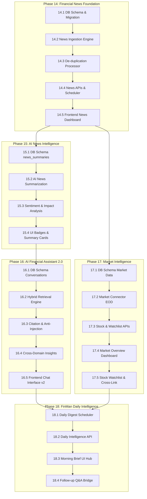

# KẾ HOẠCH TRIỂN KHAI FINMAN 2.0: AI FINANCIAL & MARKET INTELLIGENCE
## (IMPLEMENTATION PLAN FOR REVIEW & COMMENTS)

> **Dự án**: FinMan — AI-Powered Personal Finance & Market Intelligence Platform  
> **Phiên bản kế hoạch**: 2.0.0-DRAFT  
> **Ngày lập**: 04/11/2026  
> **Trạng thái**: Chờ người dùng Review & Góp ý (Pending User Comments)

---

## 1. TỔNG QUAN & NGUYÊN TẮC BẤT BIẾN

### 1.1 Mục Tiêu
Nâng cấp toàn diện ứng dụng FinMan từ một hệ thống quản lý tài chính cá nhân nội bộ thành **Nền tảng Quản lý Tài chính Cá nhân & Thông tin Thị trường Thông minh**, kết hợp hoàn hảo giữa **sổ cái thu chi thực tế của người dùng** với **dữ liệu kinh tế vĩ mô và thị trường chứng khoán bên ngoài**, dưới sự điều phối của **Google Gemini AI**.

### 1.2 Nguyên Tắc Bất Biến (Ground Rules)
1. **Bảo Toàn 100% Phân Hệ Cốt Lõi (Core Finance)**: Toàn bộ 52 tasks thuộc Phase 0 – 13 (Tài khoản mục đích, Giao dịch 3 luồng Thu-Chi-Chuyển khoản, Ngân sách, Thống kê, POI Excel, Thùng rác, Mobile Bottom Nav) **giữ nguyên vẹn tuyệt đối**, không tái cấu trúc làm gián đoạn hệ thống đang chạy Production.
2. **Kiến Trúc Modular Monolith**: Phát triển các module mới (`news`, `market`, `ai`, `scheduler`) ngay trong cấu trúc Spring Boot 3.x hiện tại, không chuyển sang Microservices.
3. **PostgreSQL Zero-Downtime Migration**: Toàn bộ bảng mới được bổ sung độc lập hoặc chỉ liên kết khóa ngoại với `users(id)`, không chỉnh sửa hay xóa bất kỳ cột nào của 5 bảng cốt lõi hiện có.
4. **Kiểm Soát Token AI & Chi Phí 0 VNĐ**: Bắt buộc Caching 100% kết quả tóm tắt tin tức vào database (`news_summaries`); mỗi bài báo chỉ gọi Gemini một lần duy nhất.
5. **Tính Xác Thực & Phòng Vệ Prompt Injection**: Toàn bộ nội dung báo chí crawl từ internet được bọc trong thẻ sandbox `<untrusted_external_news>`; AI bắt buộc dẫn nguồn [Citations] và không được tự bịa số liệu tài chính.

---

## 2. LỘ TRÌNH TRIỂN KHAI CHI TIẾT (5 PHASES MỞ RỘNG)



---

### GIAI ĐOẠN 1: THU THẬP & QUẢN TRỊ TIN TỨC TÀI CHÍNH (PHASE 14)

#### Mục tiêu
Xây dựng nền tảng tự động thu thập tin tức từ các báo tài chính hàng đầu Việt Nam (VnExpress Kinh Doanh, CafeF, Vietstock) và quốc tế (NewsAPI), chuẩn hóa dữ liệu, loại trừ tin trùng và cung cấp màn hình đọc tin tức chuyên nghiệp.

#### Danh sách công việc (Tasks):
- **Task 14.1**: Tạo Migration script `V2__news_foundation.sql` tạo 4 bảng: `news_sources`, `news_categories`, `news_articles`, `user_saved_articles`. Cấu hình GIN index cho Full-Text Search trên tiêu đề và mô tả. Tạo các Entity JPA trong `com.finman.entity`.
- **Task 14.2**: Xây dựng `NewsCollectorService` và `RssFeedParser` đọc XML/RSS định kỳ, bóc tách thẻ HTML rác bằng `getTextContent()`, xử lý XXE protection đầy đủ, trích xuất ảnh thumbnail sạch, chuẩn hóa ngày xuất bản UTC (bỏ qua bài viết nếu ngày không hợp lệ, tuyệt đối không dùng `Instant.now()`), chuẩn hóa title hash theo định dạng `SHA-256(normalized_title + source_id)`.
- **Task 14.3**: Xây dựng `NewsDeduplicationService` quản lý de-duplication chính xác qua exact match (`title_hash`, `original_url`) kết hợp kiểm tra near duplicate.
- **Task 14.4**: Xây dựng `NewsController` với các endpoint:
  - `GET /api/v1/news/categories`
  - `GET /api/v1/news/articles` (phân trang, lọc category, source, date, search keyword qua PostgreSQL FTS)
  - `GET /api/v1/news/articles/{id}`
  - `POST & DELETE /api/v1/news/articles/{id}/save`
  - Cấu hình `@Scheduled(cron = "0 */30 * * * *")` tự động crawl mỗi 30 phút, tách biệt xử lý độc lập từng source (lỗi source này không làm dừng source khác).
- **Task 14.5**: Xây dựng Frontend News Dashboard (`/tin-tuc-tai-chinh`):
  - Bộ lọc danh mục dạng thẻ ngang (Chips: Chứng khoán, Kinh tế vĩ mô, Ngân hàng, Đầu tư, Tài chính cá nhân).
  - Lưới bài viết (News Cards) với ảnh thumbnail, nhãn nguồn báo, thời gian xuất bản thân thiện (ví dụ: "2 giờ trước").
  - Modal đọc bài viết sạch và nút đánh dấu lưu bài viết.

---

### GIAI ĐOẠN 2: AI NEWS INTELLIGENCE (PHASE 15)

#### Mục tiêu
Dùng Gemini API tự động phân tích mọi bài viết mới: tóm tắt 3 bullet points, phân tích sắc thái thị trường (Sentiment), trích xuất mã cổ phiếu và lưu cache vĩnh viễn vào DB để tối ưu chi phí token.

#### Danh sách công việc (Tasks):
- **Task 15.1**: Tạo Migration script `V3__news_ai_summaries.sql` tạo bảng `news_summaries` (khóa ngoại 1-1 với `news_articles`). Xây dựng entity `NewsSummary` và repository.
- **Task 15.2**: Xây dựng `NewsAiService` kết nối Gemini API với Structured Prompt:
  - Tóm tắt bài báo thành đúng **3 bullet points ngắn gọn** nêu rõ: Sự kiện chính, con số quan trọng, hệ quả tức thời.
  - Tự động nhận diện mã cổ phiếu niêm yết xuất hiện trong bài (`related_tickers`: ví dụ `VCB, FPT`).
  - Bắt buộc caching kết quả vào bảng `news_summaries` (mỗi bài báo chỉ gọi Gemini đúng 1 lần duy nhất, tránh gọi lặp lại khi có request trùng).
- **Task 15.3**: Xây dựng `NewsSentimentService` phân loại sắc thái:
  - 3 mức: `POSITIVE`, `NEGATIVE`, `NEUTRAL`.
  - Bắt buộc trả về câu **giải thích căn cứ phân loại** và phân tích tác động đối tượng hưởng lợi / chịu rủi ro.
- **Task 15.4**: Nâng cấp giao diện Frontend News:
  - Thêm thẻ `AiSummaryCard` hiển thị nổi bật 3 ý tóm tắt ngay đầu bài viết.
  - Thêm huy hiệu `SentimentBadge` màu sắc trực quan (Xanh lá / Đỏ / Vàng).
  - Thêm các chip mã cổ phiếu có thể click để xem thông tin liên quan.

---

### GIAI ĐOẠN 3: AI FINANCIAL ASSISTANT 2.0 (PHASE 16)

#### Mục tiêu
Nâng cấp chatbot Gemini hiện tại thành Trợ lý Tài chính Toàn diện: có khả năng truy xuất bài báo liên quan bằng PostgreSQL FTS, trích dẫn nguồn tin cậy [Citations], chống tấn công Prompt Injection và đối chiếu sự kiện vĩ mô với sổ cái thu chi cá nhân của user.

#### Danh sách công việc (Tasks):
- **Task 16.1**: Tạo Migration script `V4__ai_conversations.sql` tạo 3 bảng: `ai_conversations`, `ai_messages`, `ai_message_sources`.
- **Task 16.2**: Xây dựng `HybridContextBuilder`:
  - Trích xuất số liệu cá nhân: Tổng số dư 5 loại ví, ngân sách tháng, top 3 khoản chi lớn nhất (ràng buộc tuyệt đối `userId = currentUserId`).
  - Trích xuất tin tức thị trường: Tìm kiếm Top 3 bài báo liên quan nhất qua PostgreSQL Full-Text Search.
- **Task 16.3**: Xây dựng `CitationProcessor` và phòng vệ bảo mật:
  - Bọc tin tức crawl trong thẻ `<untrusted_external_news>` để chống Prompt Injection tuyệt đối.
  - System instructions vô hiệu hóa mọi câu lệnh can thiệp bên trong bài báo.
  - Phân tích câu trả lời của Gemini và ánh xạ các ký hiệu `[1]`, `[2]` vào bảng `ai_message_sources`.
  - Bảo mật Multi-tenant: Mọi truy vấn dữ liệu tài chính cá nhân bắt buộc lấy `userId` từ Security Context (`currentUserId`), tuyệt đối không tin tưởng param hay body gửi lên.
- **Task 16.4**: Xây dựng `PersonalizedInsightEngine`:
  - Cho phép AI đối chiếu sự kiện (ví dụ: lãi suất tiền gửi tăng) với số dư ví tiết kiệm thực tế của user, đưa ra so sánh lợi nhuận cụ thể và kèm theo Financial Disclaimer.
- **Task 16.5**: Nâng cấp giao diện `AIAssistantPage.tsx`:
  - Sidebar danh sách các phiên trò chuyện cũ bên trái.
  - Bong bóng tin nhắn hỗ trợ rich markdown và **Citation Chips** (bấm vào chip sẽ mở popup xem nguồn bài báo tương ứng).

---

### GIAI ĐOẠN 4: MARKET INTELLIGENCE (PHASE 17)

#### Mục tiêu
Cung cấp dữ liệu thị trường tài chính thiết thực cho quản lý tài sản: bảng điểm chỉ số VN-Index, HNX, VN30 (độ trễ 15 phút hoặc EOD), tra cứu mã cổ phiếu, lịch sử giá và danh sách theo dõi cá nhân (Watchlist).

#### Danh sách công việc (Tasks):
- **Task 17.1**: Tạo Migration script `V5__market_intelligence.sql` tạo 4 bảng: `market_indices`, `stock_symbols`, `stock_price_history`, `user_watchlists`.
- **Task 17.2**: Xây dựng `MarketDataService` kết nối nguồn dữ liệu thị trường mở (Vietstock / SSI / TCBS / AlphaVantage) cập nhật chỉ số phiên giao dịch và lưu chốt giá cuối ngày (EOD 15:30).
- **Task 17.3**: Xây dựng `MarketController` với các API tra cứu mã chứng khoán, lịch sử giá và CRUD Watchlist cá nhân theo `userId`.
- **Task 17.4**: Xây dựng màn hình Thị Trường (`/thi-truong`):
  - Bảng điểm 3 chỉ số lớn VN-Index, HNX, VN30 kèm biến động điểm và tỷ lệ %.
  - Biểu đồ biến động điểm số dạng Line Chart.
- **Task 17.5**: Xây dựng bảng Watchlist cá nhân:
  - Cho phép gắn sao mã cổ phiếu quan tâm.
  - Khi click vào mã cổ phiếu: Hiển thị popup chi tiết doanh nghiệp, biểu đồ giá và danh sách bài báo mới nhất có nhắc đến mã đó.

---

### GIAI ĐOẠN 5: FINMAN DAILY INTELLIGENCE (PHASE 18)

#### Mục tiêu
Tự động tổng hợp bản tin tài chính sáng hàng ngày (Morning Brief) lúc 06:30 AM: kết hợp nhịp đập thị trường, top tin tức nổi bật, nhận định AI vĩ mô và 1 gợi ý tối ưu ngân sách cá nhân hóa; hỗ trợ hỏi đáp tiếp nối trực tiếp với AI.

#### Danh sách công việc (Tasks):
- **Task 18.1**: Xây dựng `@Scheduled(cron = "0 30 6 * * *")` chạy lúc 06:30 sáng: gom top 5 bài báo hot nhất 24h qua, dữ liệu đóng cửa phiên trước, gọi Gemini tạo 1 đoạn tóm tắt vĩ mô 4 dòng và lưu vào cache.
- **Task 18.2**: Xây dựng API `GET /api/v1/daily-intelligence/today` trả về gói dữ liệu bản tin sáng kết hợp cảnh báo tiến độ ngân sách tháng của user đang đăng nhập trong < 50ms (đọc kết quả đã được scheduler tính toán và cache sẵn, không gọi Gemini trực tiếp trong request).
- **Task 18.3**: Xây dựng màn hình Bản Tin Sáng (`/ban-tin-hang-ngay`) phong cách Tạp chí Tài chính Tinh gọn (Executive Brief): Thẻ Market Pulse, Top Headlines, AI Digest và Góc cảnh báo ngân sách.
- **Task 18.4**: Tích hợp các nút gợi ý câu hỏi nhanh (Prompt Chips) bên dưới từng mẩu tin trên bản tin; click vào sẽ chuyển tức thì sang `AIAssistantPage` để tiếp tục trò chuyện sâu.

---

## 3. THIẾT KẾ CƠ SỞ DỮ LIỆU & SCHEMA SPECIFICATION

```mermaid
erDiagram
    USERS ||--o{ USER_SAVED_ARTICLES : "saves"
    USERS ||--o{ USER_WATCHLISTS : "watches"
    USERS ||--o{ AI_CONVERSATIONS : "has"
    AI_CONVERSATIONS ||--o{ AI_MESSAGES : "contains"
    AI_MESSAGES ||--o{ AI_MESSAGE_SOURCES : "cites"

    NEWS_SOURCES ||--o{ NEWS_ARTICLES : "publishes"
    NEWS_CATEGORIES ||--o{ NEWS_ARTICLES : "classifies"
    NEWS_ARTICLES ||--o| NEWS_SUMMARIES : "summarized by"
    NEWS_ARTICLES ||--o{ USER_SAVED_ARTICLES : "saved in"
    NEWS_ARTICLES ||--o{ AI_MESSAGE_SOURCES : "referenced by"

    STOCK_SYMBOLS ||--o{ STOCK_PRICE_HISTORY : "has"
    STOCK_SYMBOLS ||--o{ USER_WATCHLISTS : "included in"

    NEWS_ARTICLES {
        bigint id PK
        bigint source_id FK
        bigint category_id FK
        varchar title
        varchar title_hash UK
        text description
        varchar original_url
        timestamp published_at
    }

    NEWS_SUMMARIES {
        bigint id PK
        bigint article_id FK_UK
        jsonb bullet_points
        varchar sentiment
        text sentiment_reason
        text impact_analysis
        varchar related_tickers
    }

    STOCK_SYMBOLS {
        bigint id PK
        varchar ticker UK
        varchar company_name
        varchar exchange
        bigint current_price
    }

    AI_CONVERSATIONS {
        bigint id PK
        bigint user_id FK
        varchar title
    }
```

---

## 4. MA TRẬN TRẠNG THÁI TÍNH NĂNG TOÀN DỰ ÁN

| Phân Hệ | Nhóm Tính Năng | Trạng Thái | Kế Hoạch / Ghi Chú |
|---|---|---|---|
| **Core Finance** | Xác thực JWT, Google OAuth 2.0, Quên mật khẩu | `COMPLETED` | Đã chạy ổn định Production |
| **Core Finance** | 5 loại tài khoản mục đích, Archive/Unarchive, Net Worth | `COMPLETED` | Đã hoàn thành 100% |
| **Core Finance** | Giao dịch 3 luồng (Thu, Chi, Chuyển khoản nội bộ), Lọc ngày | `COMPLETED` | Đã hoàn thành 100% |
| **Core Finance** | Ngân sách tháng theo danh mục, cảnh báo 3 cấp độ | `COMPLETED` | Đã hoàn thành 100% |
| **Core Finance** | Thống kê dòng tiền, xuất file POI Excel native | `COMPLETED` | Đã hoàn thành 100% |
| **Core Finance** | Thùng rác (Recycle Bin - Xóa mềm, khôi phục) | `COMPLETED` | Đã hoàn thành 100% |
| **Core Finance** | Desktop Stitch Canvas, Mobile Bottom Nav, Bong bóng AI nổi | `COMPLETED` | Đã hoàn thành 100% |
| **Core Finance** | 200 Backend Tests, 10 Playwright Specs, Docker Prod | `COMPLETED` | Đã hoàn thành 100% |
| **Module 1 (News)** | Thu thập RSS/API, lọc trùng SHA-256, PostgreSQL FTS, News UI | `PLANNED` | **Phase 14** (5 tasks) |
| **Module 2 (AI News)** | Tóm tắt 3 ý, phân tích sắc thái, bóc tách cổ phiếu, Caching DB | `PLANNED` | **Phase 15** (4 tasks) |
| **Module 4 (Assistant)**| Hỏi đáp tin tức, dẫn nguồn [Citations], Cross-domain Insights | `PLANNED` | **Phase 16** (5 tasks) |
| **Module 3 (Market)** | VN-Index/HNX/VN30, Tra cứu mã cổ phiếu, Lịch sử giá EOD, Watchlist | `PLANNED` | **Phase 17** (5 tasks) |
| **Module 5 (Daily)** | Scheduler 06:30 sinh bản tin sáng, Morning Brief UI, Q&A Bridge | `PLANNED` | **Phase 18** (4 tasks) |
| **Advanced Market** | Dữ liệu Real-time WebSocket, sổ lệnh Level 2, đặt lệnh tự động | `FUTURE ENHANCEMENT` | Cần hợp tác với công ty chứng khoán |
| **Commercial Feeds** | Tích hợp FiinGroup / Bloomberg Terminal API trả phí | `BLOCKED` | Tạm hoãn đến khi có ngân sách doanh nghiệp |

---

## 5. KẾ HOẠCH KIỂM THỬ (TESTING STRATEGY)

### 5.1 Kiểm Thử Backend (JUnit 5 & Mockito)
- **Kiểm thử Thu thập Tin tức**: Kiểm tra Parser RSS feeds với các format báo chí khác nhau, loại bỏ HTML tags, kiểm thử de-duplication với mã băm SHA-256.
- **Kiểm thử PostgreSQL Full-Text Search**: Kiểm tra độ chính xác của câu lệnh `to_tsquery` với từ khóa tiếng Việt có dấu và không dấu.
- **Kiểm thử AI Caching**: Đảm bảo gọi lại bài viết đã tóm tắt không phát sinh cuộc gọi mạng nào đến Gemini API.
- **Kiểm thử Bảo Mật Multi-tenant**: Kiểm tra tuyệt đối không có rò rỉ số dư hoặc lịch sử giao dịch của User A sang prompt hội thoại của User B.
- **Kiểm thử Chống Prompt Injection**: Gửi bài báo có chứa câu lệnh phá hoại, xác thực hệ thống thẻ `<untrusted_external_news>` triệt tiêu chỉ thị độc hại.

### 5.2 Kiểm Thử E2E Tự Động Với Playwright
Bổ sung 4 file kịch bản mới trong thư mục `tests/`:
- `09_news.spec.ts`: Đọc danh sách tin tức, chuyển đổi tab danh mục, tìm kiếm bài viết và mở modal đọc tóm tắt AI.
- `10_market.spec.ts`: Xem bảng điểm chỉ số VN-Index, tra cứu mã cổ phiếu `FPT`, thêm/xóa mã khỏi Watchlist.
- `11_ai_assistant_v2.spec.ts`: Đặt câu hỏi kinh tế, kiểm tra hiển thị chip trích dẫn nguồn, click chip mở bài báo gốc; hỏi kết hợp số dư ví tiết kiệm cá nhân.
- `12_daily_intelligence.spec.ts`: Mở bản tin sáng lúc 07:00, xem 4 khối thông tin, click câu hỏi gợi ý tự động chuyển tab AI chat với ngữ cảnh sẵn.

---

## 6. CÁC QUYẾT ĐỊNH & CÂU HỎI CẦN BẠN GÓP Ý (OPEN QUESTIONS)

Xin mời bạn để lại nhận xét (comment) hoặc điều chỉnh đối với 3 quyết định trọng tâm sau:

1. **Về Nguồn Tin Tức (Phase 14)**:
   - *Đề xuất hiện tại*: Ưu tiên hàng đầu các nguồn RSS tiếng Việt miễn phí (VnExpress Kinh Doanh, CafeF, Vietstock) vì tốc độ nhanh, không giới hạn request, độ ổn định cao. Nguồn quốc tế NewsAPI chỉ dùng cho tin vĩ mô thế giới (FED, lạm phát Mỹ).
   - *Câu hỏi cho bạn*: Bạn có muốn bổ sung thêm trang báo tài chính nào khác không?
2. **Về Dữ Liệu Thị Trường Chứng Khoán (Phase 17)**:
   - *Đề xuất hiện tại*: Sử dụng dữ liệu chốt phiên cuối ngày (End-of-Day EOD) và cập nhật chỉ số phiên có độ trễ 15 phút từ các nguồn mở miễn phí. Không triển khai dữ liệu Real-time WebSocket vì chi phí bản quyền dữ liệu tài chính rất cao.
   - *Câu hỏi cho bạn*: Bạn có đồng ý với phương án EOD & Delayed 15 phút này cho giai đoạn đồ án không?
3. **Thứ Tự Triển Khai Coding**:
   - *Đề xuất hiện tại*: Bắt đầu tuần tự từ **Phase 14 (Tin tức nền tảng)** $\rightarrow$ **Phase 15 (AI Tóm tắt tin)** $\rightarrow$ **Phase 16 (Trợ lý AI nâng cao)** $\rightarrow$ **Phase 17 (Thị trường & Cổ phiếu)** $\rightarrow$ **Phase 18 (Bản tin sáng Daily)**.
   - *Câu hỏi cho bạn*: Bạn có muốn ưu tiên phân hệ nào làm trước không?

